<p align="center">
  
</p>

<p align="center">
  <a href="#-quick-start"></a>
  <a href="docs/Worko-User-Guide.pdf"></a>
  
  
</p>

<p align="center">
  <b>Worko</b> runs a CA / CS firm end-to-end — tasks, statutory compliance, billing, time, clients, documents and a branded client portal —<br>
  on the <b>web</b>, a <b>desktop</b> app and an <b>Android</b> app that keep working offline and sync the moment you are back online.
</p>

---

## ⬇️ Download

<table>
<tr>
<td align="center" width="25%"><h3>🪟 Windows</h3><a href="https://github.com/gyuv/worko-office/releases"><b>Worko-Setup.exe</b></a><br><sub>Windows 10 / 11 · 64-bit</sub></td>
<td align="center" width="25%"><h3>🍎 macOS</h3><a href="https://github.com/gyuv/worko-office/releases"><b>Worko.dmg</b></a><br><sub>Apple Silicon (arm64) · Intel</sub></td>
<td align="center" width="25%"><h3>🤖 Android</h3><a href="https://github.com/gyuv/worko-office/releases"><b>Worko.apk</b></a><br><sub>Android 8+ · sideload</sub></td>
<td align="center" width="25%"><h3>🌐 Web</h3><a href="https://worko-office.vercel.app"><b>Open in browser</b></a><br><sub>Nothing to install</sub></td>
</tr>
</table>

<p align="center"><a href="https://github.com/gyuv/worko-office/releases"></a></p>

> [!TIP]
> **Install once — it updates itself.** Every app checks for a new version each time it starts. Windows updates with one click, macOS opens the new installer, Android asks once to install, and the web app offers a reload. Check any time in **Appearance → About & updates**.

<details>
<summary><b>First-time install help</b></summary>

| | Steps |
|---|---|
| **Windows** | Run the `.exe`. If SmartScreen appears: **More info → Run anyway** (the build is not code-signed yet). |
| **macOS** | Open the `.dmg` for your Mac (`arm64` = Apple Silicon), drag **Worko** to Applications, then **right-click → Open** the first time. |
| **Android** | Download the `.apk` on the phone, allow **Install unknown apps** for your browser, then tap the file. |

</details>

---

## ✨ Built for the daily grind

<table>
<tr>
<td width="50%" valign="top">

### ⚡ Quick add — one line, done
Press <kbd>N</kbd> anywhere (or the green <b>+</b>) and type the way you speak:

```text
File GSTR-3B #acme tomorrow !! @ravi
```

Worko picks out the **client**, **date**, **priority** and **person** as live chips. <kbd>Enter</kbd> saves, and the box stays open for the next one.

| Type | Means |
|---|---|
| `today` `tomorrow` `fri` `15/11` `in 3 days` | due date |
| `#acme` | client |
| `@ravi` · `@me` | assignee |
| `!` `!!` `!!!` | high · high · urgent |

</td>
<td width="50%" valign="top">
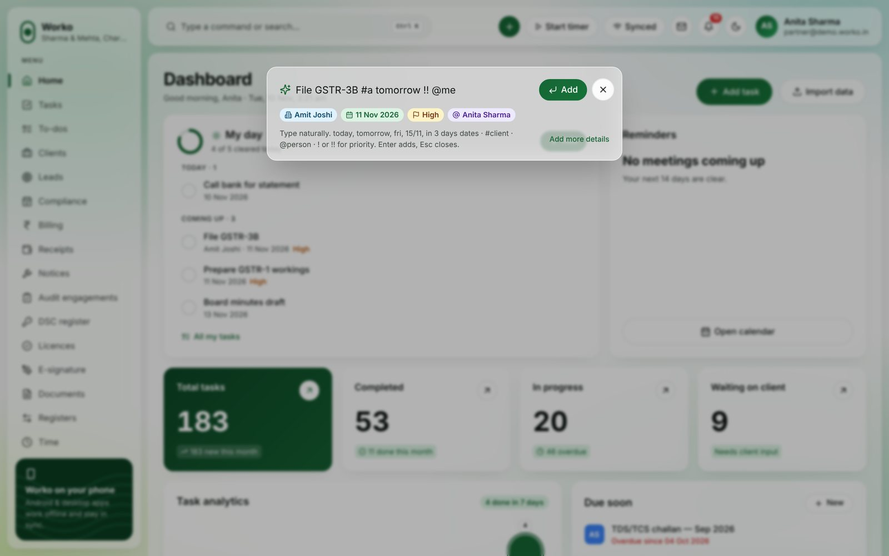
</td>
</tr>
<tr>
<td width="50%" valign="top">
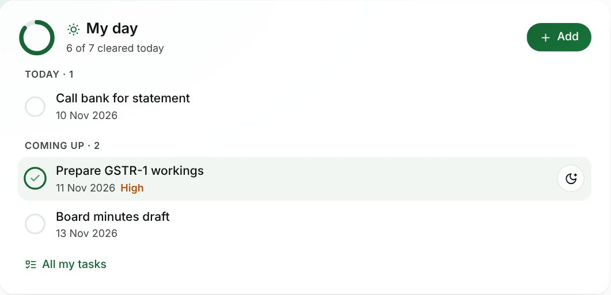
</td>
<td width="50%" valign="top">

### ☀️ My day — one tap to finish
The top of the dashboard shows **only your work**: overdue, today and the coming week.

- ✅ **Tick** to finish — the row strikes through and slides away
- 🌙 **Moon** to move it to tomorrow
- ↩️ **Undo** from the toast if you slipped
- 🔒 Tasks with open checklist items open the task instead

Same card on Android, and it works **offline**.

</td>
</tr>
</table>

---

## 🖼️ A look around

<p align="center">
  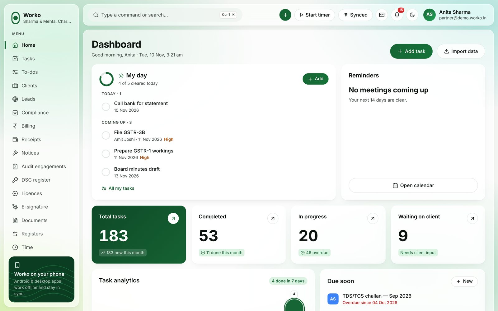
</p>

<table>
<tr>
<td width="50%">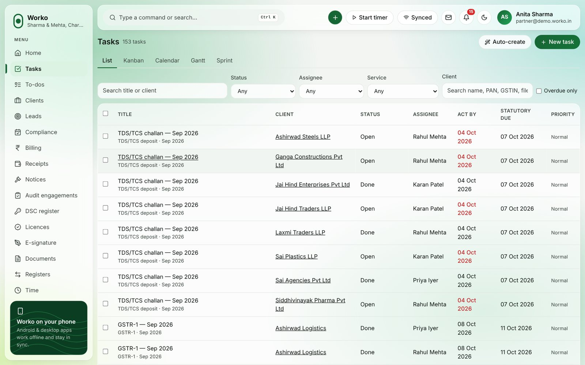<p align="center"><b>Tasks</b> · list, kanban, calendar, Gantt, sprint</p></td>
<td width="50%">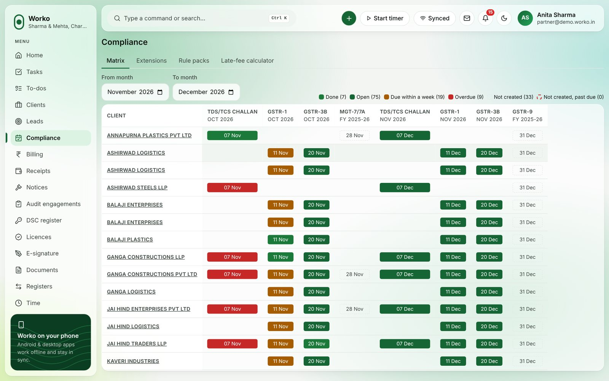<p align="center"><b>Compliance</b> · matrix from rule packs</p></td>
</tr>
<tr>
<td>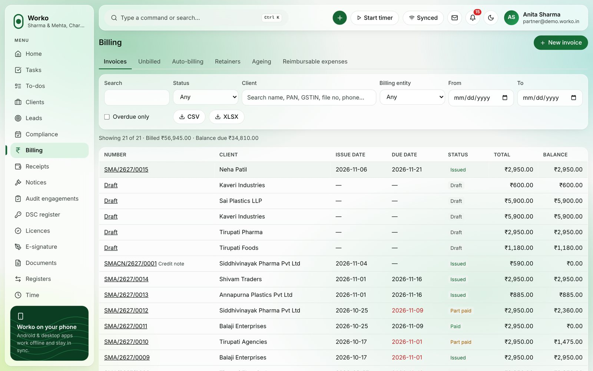<p align="center"><b>Billing</b> · GST invoices, ageing, Tally</p></td>
<td>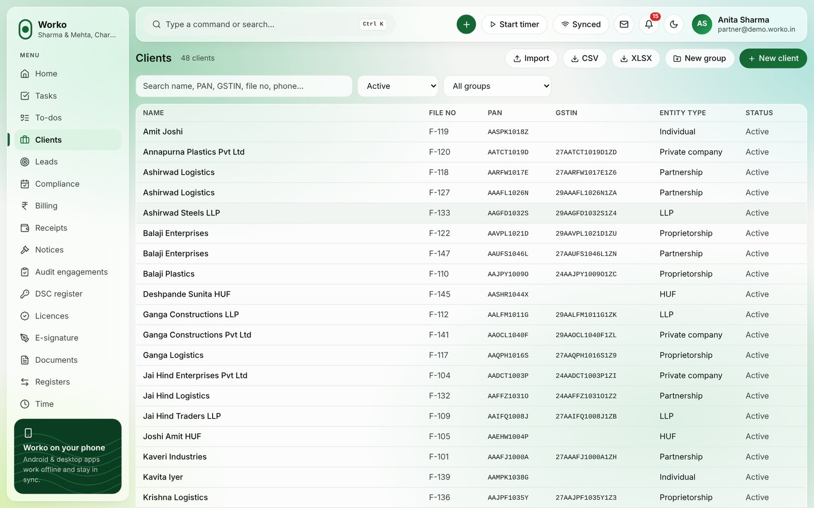<p align="center"><b>Clients</b> · PAN/GSTIN checks, groups, access</p></td>
</tr>
<tr>
<td>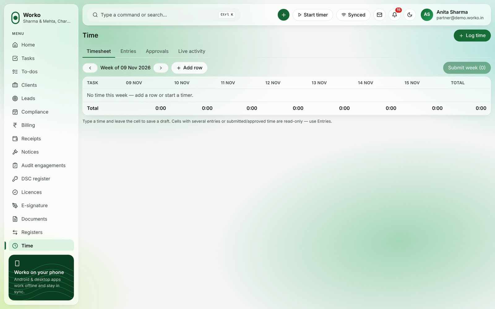<p align="center"><b>Time</b> · timers, timesheets, job P&amp;L</p></td>
<td>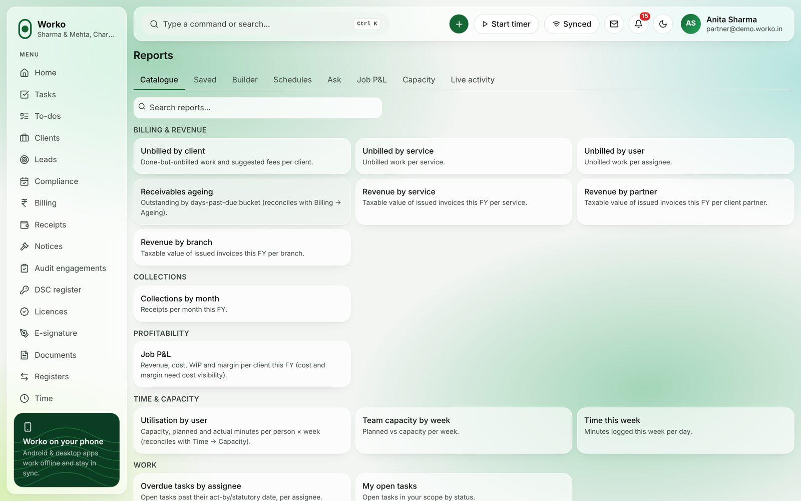<p align="center"><b>Reports</b> · builder, dashboards, schedules</p></td>
</tr>
<tr>
<td>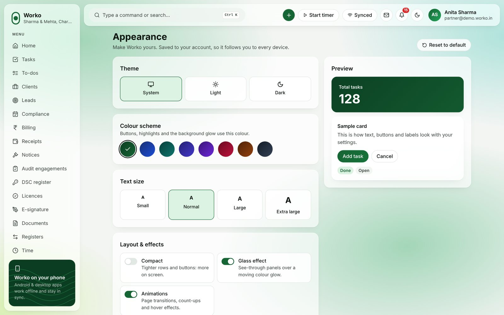<p align="center"><b>Appearance</b> · 8 accents, text size, density, motion</p></td>
<td>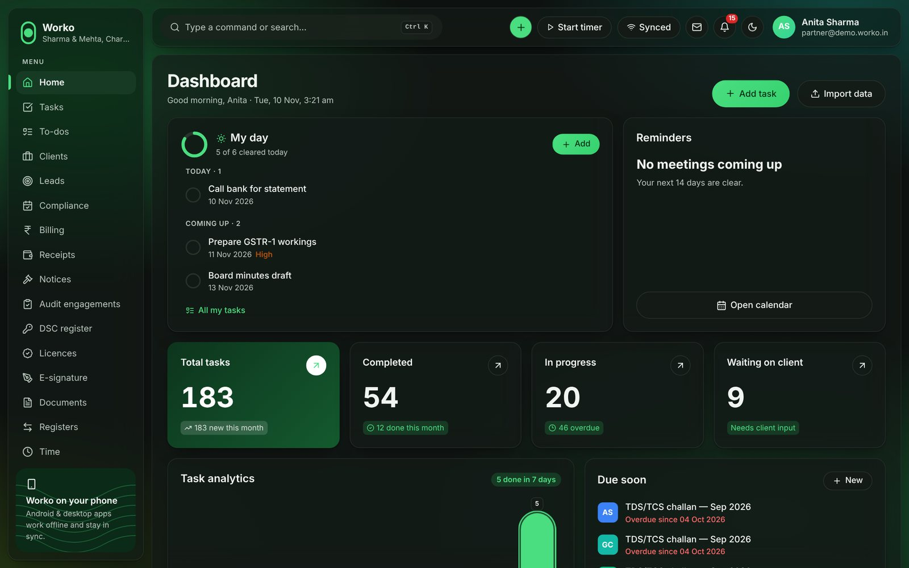<p align="center"><b>Dark mode</b> · glass UI, AA contrast</p></td>
</tr>
</table>

<p align="center">
  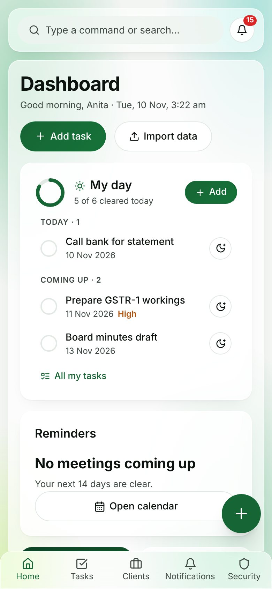
  &nbsp;&nbsp;
  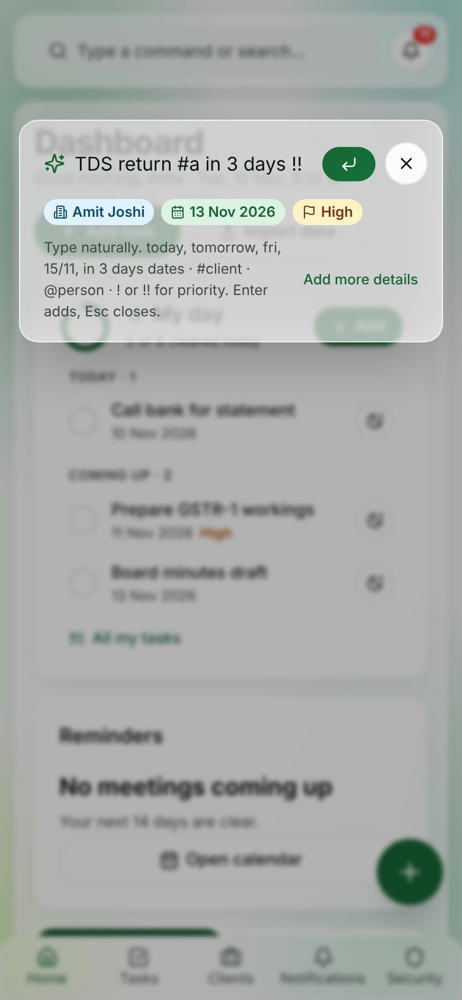
  &nbsp;&nbsp;
  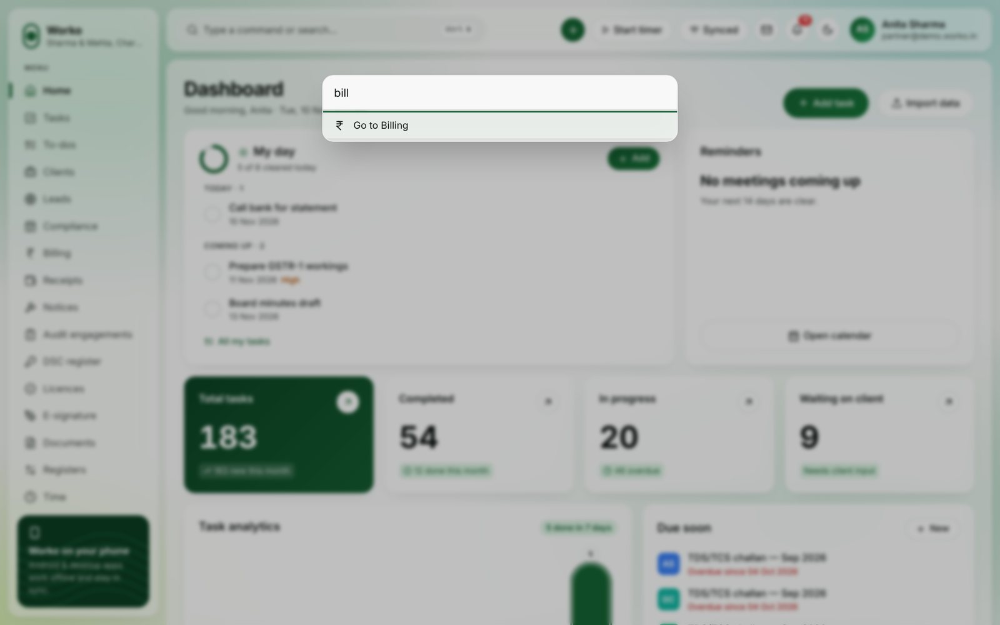
</p>

---

## 🧭 What's inside

| | Area | Highlights |
|:-:|---|---|
| 👥 | **Clients & documents** | GSTIN/PAN validation, client groups, per-client visibility, encrypted personal data · versioned document store, share links, inward/outward registers · credential vault + browser extension that fills government-portal logins |
| ✅ | **Tasks & compliance** | Service catalogue · tasks auto-created from compliance rule packs · checklists and review before done · UDIN gate on audit tasks · compliance matrix, due-date extensions |
| 🧾 | **Billing & collections** | GST invoices (CGST/SGST/IGST), credit/debit notes, receipts with TDS · ageing, auto-billing, reminders, payment links · Tally XML export |
| ⏱️ | **Time & HR** | Timers, timesheets, cost rates, job P&L, capacity · attendance by location/office network, leave ledger, expenses |
| 💬 | **Communication** | Email · WhatsApp · SMS respecting consent and quiet hours · broadcasts, client timeline, team chat, calendar (ICS), booking pages |
| ⚖️ | **Practice** | Notices & hearings, audit programmes and sign-offs, PBC lists, UDIN · DSC register, licences, e-signature |
| 🤝 | **Client portal & CRM** | OTP login, see only what's granted, upload/answer/pay · leads pipeline, versioned proposals, online acceptance, conversion |
| 🤖 | **Automation & AI** | Trigger → conditions → actions, prebuilt agents, dry runs · AI off by default; redacts personal data; every suggestion needs a human |
| 📊 | **Reports** | Catalogue + builder, dashboards, drill-down, CSV/XLSX/PDF, schedules, questions in plain language |
| 🛡️ | **Platform** | Super-admin console, plans and seat limits, consent-based support access · DPDP tooling, public API keys, signed webhooks |

> [!NOTE]
> Modules that need an outside account (payment gateway, WhatsApp/SMS, e-sign, AI, calendar sync) **hide themselves until that account is connected**. Add the keys in your server environment and they switch on — see [docs/KNOWN_GAPS.md](docs/KNOWN_GAPS.md).

---

## 🏗️ Architecture

<p align="center"></p>

<details>
<summary><b>Design principles</b></summary>

- **One source of truth.** Every app talks to the same NestJS API; Postgres row-level security isolates each firm.
- **Offline first.** Desktop and Android keep a local store and an outbox; field-level versions merge edits safely.
- **Every change is audited** in the same transaction, on a hash-chained log.
- **Money in paise, dates in IST,** statutory dates and prices only from rule packs — never hard-coded.
- **Secrets encrypted per tenant** (envelope keys); reveals need step-up auth and are audited.
- **Accessible by default:** AA contrast in every theme and accent, keyboard-first, reduced-motion honoured.

</details>

---

## 🚀 Quick start

> Needs **Node 22**, **pnpm 10**, and **Docker** (or a local Postgres 16).

```bash
pnpm install
docker compose up -d                 # Postgres 16, Redis, MinIO, Mailpit
cp .env.example .env
pnpm --filter @worko/api migrate
pnpm seed:demo                       # firm "demo" · password Demo@12345
pnpm dev                             # API :3000 · web :5173
```

| Command | What it does |
|---|---|
| `pnpm desktop:dev` | Electron desktop app |
| `pnpm mobile:dev` | Expo / Android app |
| `pnpm build && pnpm typecheck && pnpm lint` | Full build and static checks |
| `TEST_DATABASE_URL=postgres://… pnpm test` | Unit + integration tests |

> [!WARNING]
> The demo logins printed by the seed are **for development only** — never deploy them.

<details>
<summary><b>☁️ Free-tier deployment (Render + Neon + Vercel + Cloudflare R2)</b></summary>

1. **Database:** create a Neon Postgres project (Singapore is closest to India) and copy its connection string.
2. **API:** deploy `render.yaml` as a Render Blueprint; set `DATABASE_URL`, `DB_DRIVER=neon`, `SAAS_FREE_FOREVER=1` and your `PLATFORM_ADMIN_EMAIL` / `PLATFORM_ADMIN_PASSWORD`.
3. **Web:** import the repo in Vercel with root `apps/web` and set `VITE_API_URL` to your Render URL.
4. **Files:** create a Cloudflare R2 bucket and set the `S3_*` variables on Render.
5. Sign in to `#/platform`, scan the setup key into your authenticator, and create your first firm.

Full steps: [docs/DEPLOY.md](docs/DEPLOY.md).

</details>

---

## 🗂️ Repository layout

```text
apps/
  api/         NestJS API · SQL migrations (db/) · integration + e2e tests
  web/         React app — also the desktop renderer and the client portal
  desktop/     Electron main process · installers (electron-builder.yml)
  mobile/      Expo Android app (staff + client-portal modes) · EAS config
  extension/   MV3 browser extension for vault autofill
packages/
  domain/      Pure business rules: GST, FY, permissions, quick-add parser…
  rules/       Compliance rule engine + JSON rule packs
  sync/        Offline sync engine, stores, realtime client
  notify/      Notification categories, quiet hours, offline reminders
  api-client/  Generated from docs/openapi.yaml
  ui-tokens/   Colours, accents, glass — shared by all apps
  i18n/        Every UI string
scripts/       Backup / restore drill (dr/) · browser smoke (e2e/) · secret scan
docs/          Specs, decisions, API, data model, manual, release + DR guides
```

---

## 📚 Documentation

| For | Read |
|---|---|
| **People using Worko** | 📘 [**User guide (PDF)**](docs/Worko-User-Guide.pdf) · [User manual](docs/manual/README.md) |
| **Running it** | [Deploy](docs/DEPLOY.md) · [Release checklist](docs/RELEASE.md) · [Disaster recovery](docs/DR.md) · [Release notes](docs/releases/) |
| **Developers** | [PRD](docs/PRD.md) · [Roadmap](docs/ROADMAP.md) · [Progress](PROGRESS.md) · [Decisions](docs/DECISIONS.md) · [Known gaps](docs/KNOWN_GAPS.md) · [API guide](docs/API.md) · [OpenAPI](docs/openapi.yaml) · [Data model](docs/DATA_MODEL.md) · [Integrations](docs/INTEGRATIONS.md) · [Conventions](CLAUDE.md) |

> [!IMPORTANT]
> All roadmap phases (0–12) are built. Before going live, work through [docs/RELEASE.md](docs/RELEASE.md) and [docs/KNOWN_GAPS.md](docs/KNOWN_GAPS.md): several third-party adapters, statutory data packs and legal time periods are **samples marked UNVERIFIED** and must be checked against official sources.

<p align="center"><sub>Made for Indian practices · Money in paise · Dates in IST · Your data, your firm.</sub></p>
