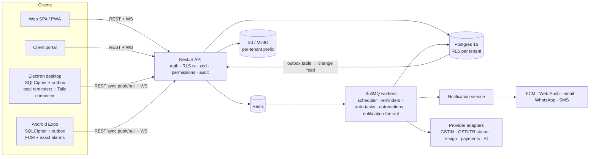
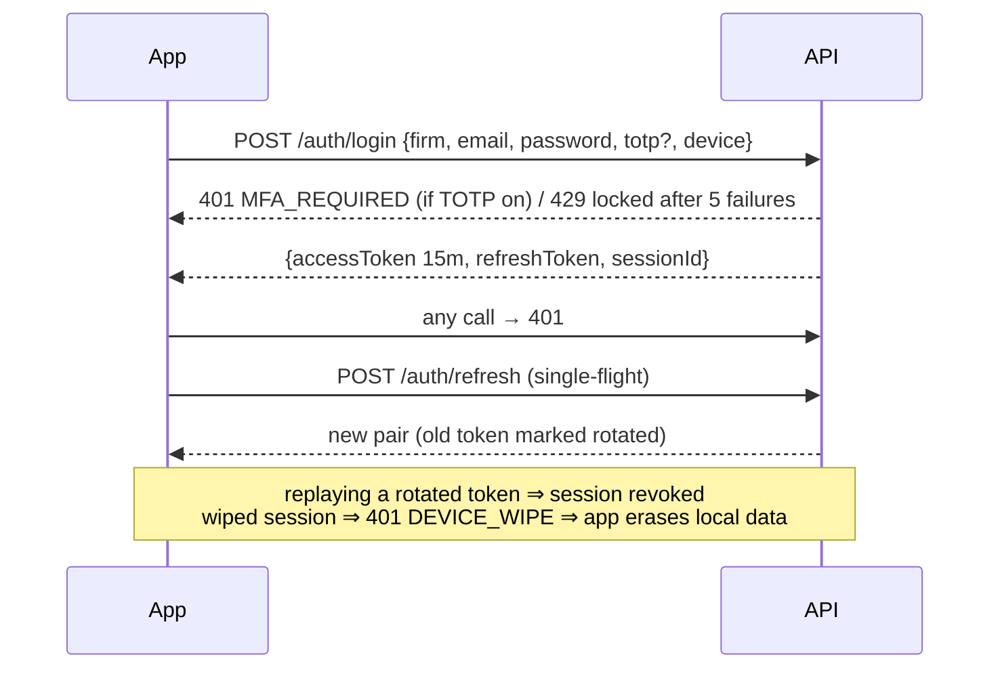

# Architecture



## Request path
1. JWT access token (15 min) + rotating refresh token bound to a `device_session` (reuse ⇒ session revoked).
2. Global `AuthGuard` verifies the JWT, checks the session isn't revoked or wipe-flagged, loads roles, then enforces `@Perm(module, action)`.
3. Every query runs in `DbService.tenantTx`: `BEGIN; SET LOCAL ROLE worko_app; set_config('app.tenant_id', …, true)` → RLS applies even if a query forgets a filter.
4. zod validation → row-level permission check (`can()` from `@worko/domain`, module × action × scope + sensitive-client list) → handler.
5. Mutations write the row **and** an `audit_log` entry **and** an `outbox_event` in the same transaction (outbox pattern).
6. Outbox relay publishes to Redis pub/sub → WebSocket gateway pushes "changed: table/cursor" hints to connected devices.

## Auth flows


## Sync (`packages/sync`)
```mermaid
sequenceDiagram
  participant Dev as Device (SQLite)
  participant API
  participant DB as Postgres
  Dev->>Dev: write locally + append mutation{idempotencyKey, baseVersion, patch}
  Dev->>API: POST /sync/push [batch]
  API->>DB: dedupe by idempotency_key; strict tables check baseVersion; LWW per field; conflict log
  DB-->>API: rows get version+1, sync_cursor=nextval
  API-->>Dev: results (applied / duplicate / rejected_stale)
  API--)Dev: WS "cursor advanced"
  Dev->>API: GET /sync/pull?since=cursor
  API-->>Dev: upserts (permission-filtered) + revoked ids + new cursor
  Dev->>Dev: re-apply pending outbox on top; purge revoked
```
- Server receive order decides LWW (no client-clock trust). Strict tables (invoice, receipt, filing status) reject stale base versions → user resolves.
- Permission revocation: rows no longer visible are returned as `revoked` and purged locally. Remote wipe: `device_session.wipe_requested_at` → next contact returns `WIPE` and the client deletes its DB and keys.
- Initial sync staged: masters → open work → history, resumable by cursor per stage.
- Convergence proven by a seeded simulator (offline toggles, dropped acks, duplicate delivery, random batch sizes) — 50 seeds in CI; scale to 10k in nightly.

## Notifications
Event → rule match (per user category prefs, quiet hours) → channel plan → delivery jobs with retry/backoff and per-channel cost caps.
Read on one device → `notification.read_at` syncs → other devices clear. Escalation: a delayed job checks ack after X hours and re-targets manager → partner.
Desktop and Android keep a local copy of the next 30 days' reminders so they fire offline.

## Security model
Envelope encryption: KMS master key → per-tenant data key → field encryption (vault secrets, Aadhaar, bank no., TOTP secret).
Vault reveal requires `vault:reveal` permission + optional step-up (TOTP), writes a hash-chained audit entry, and is never logged.
India residency (ap-south-1). See DECISIONS D3, D5, D16.

## Provider pattern
Every external dependency is an interface + mock + real adapter slot selected by env (`*_PROVIDER=mock|...`). See INTEGRATIONS.md.
