# Data model

All tenant tables carry `id uuid (v7) · tenant_id · version · updated_at · deleted_at · updated_by · device_id · sync_cursor` and RLS.
Implemented so far (`apps/api/db/0001_foundation.sql`, `0002_auth.sql`): `tenant, firm_entity, branch, app_user, role, user_role, device_session, refresh_token, otp_challenge, audit_log, idempotency_key, schema_migration`.

```mermaid
erDiagram
  TENANT ||--o{ FIRM_ENTITY : bills_as
  TENANT ||--o{ BRANCH : has
  BRANCH ||--o{ APP_USER : employs
  APP_USER }o--o{ ROLE : user_role
  APP_USER ||--o{ DEVICE_SESSION : signs_in
  TEAM ||--o{ APP_USER : members
  CLIENT }o--o{ CLIENT_GROUP : member_of
  CLIENT ||--o{ CLIENT_REGISTRATION : "GSTIN/TAN/CIN/..."
  CLIENT ||--o{ CONTACT : has
  CLIENT ||--o{ CLIENT_SERVICE : subscribes
  SERVICE_TYPE ||--o{ CLIENT_SERVICE : of
  SERVICE_TYPE ||--o{ CHECK_TEMPLATE : stages
  SERVICE_TYPE }o--|| COMPLIANCE_RULE_REF : due_by
  CLIENT_SERVICE ||--o{ TASK : generates
  TASK ||--o{ TASK_CHECK : progresses
  TASK ||--o{ TASK_ASSIGNEE : "leader/manager/assignee/reviewer"
  TASK ||--o{ TODO_ITEM : checklist
  TASK ||--o{ PENDING_ISSUE : blocked_by
  TASK ||--o{ TIME_ENTRY : logged
  TASK ||--o{ CLIENT_EXPENSE : reimbursable
  TASK }o--o| INVOICE_LINE : billed_by
  INVOICE ||--o{ INVOICE_LINE : has
  FIRM_ENTITY ||--o{ INVOICE : issues
  RECEIPT ||--o{ RECEIPT_ALLOCATION : settles
  INVOICE ||--o{ RECEIPT_ALLOCATION : settled_by
  CLIENT ||--o{ DOCUMENT : owns
  DOCUMENT ||--o{ DOCUMENT_VERSION : versions
  CLIENT ||--o{ VAULT_SECRET : credentials
  CLIENT ||--o{ DSC : tokens
  CLIENT ||--o{ NOTICE : receives
  CLIENT ||--o{ UDIN_RECORD : certified
  CLIENT ||--o{ INWARD_ENTRY : gives
  CLIENT ||--o{ OUTWARD_ENTRY : receives
  CLIENT ||--o{ MESSAGE : timeline
  RULE_PACK ||--o{ RULE_VERSION : contains
  DUE_EXTENSION }o--|| RULE_VERSION : overrides
  AUTOMATION ||--o{ AUTOMATION_RUN : history
  NOTIFICATION ||--o{ DELIVERY : attempts
```

## Key invariants
- `task.billing_state ∈ {unbilled, billed, free(reason), deleted}`; "completed & unbilled" is a first-class report.
- `task` unique on `(client_service_id, period_key)` → auto-creation is idempotent.
- Money columns are `bigint` paise; invoices/receipts are strict-sync tables.
- `invoice.number` unique per `(firm_entity_id, series, fy)`.
- `vault_secret.ciphertext` + `dek_id`; plaintext never stored or logged.
- `audit_log` append-only, `hash = sha256(prev_hash || canonical_json(row))`.
