# Data model

All tenant tables carry `id uuid (v7) · tenant_id · version · updated_at · deleted_at · updated_by · device_id · sync_cursor` and RLS.
Implemented so far (`apps/api/db/0001`–`0009`; Phase 4/5 tables listed under Key invariants): `tenant, firm_entity, branch, app_user, role, user_role, device_session, refresh_token, otp_challenge, audit_log, idempotency_key, schema_migration, team, team_member, sync_mutation, sync_conflict, notification, notification_pref, push_subscription, notification_delivery, job_queue, tenant_key, client_group, client, client_registration, contact, custom_field_def, sync_revocation, vault_secret, extension_pair_code, document, document_version, share_link, document_access_log, register_counter, inward_entry, outward_entry`.

Client membership in groups, staff assignment and the sensitive allow-list are uuid[] columns on `client` (GIN-indexed) so one row carries everything that decides visibility.

```mermaid
erDiagram
  TENANT ||--o{ FIRM_ENTITY : bills_as
  TENANT ||--o{ BRANCH : has
  BRANCH ||--o{ APP_USER : employs
  APP_USER }o--o{ ROLE : user_role
  APP_USER ||--o{ DEVICE_SESSION : signs_in
  TEAM ||--o{ APP_USER : members
  CLIENT }o--o{ CLIENT_GROUP : member_of
  CLIENT ||--o{ CLIENT_REGISTRATION : "GSTIN/TAN/CIN/..."
  CLIENT ||--o{ CONTACT : has
  CLIENT ||--o{ CLIENT_SERVICE : subscribes
  SERVICE_TYPE ||--o{ CLIENT_SERVICE : of
  SERVICE_TYPE ||--o{ CHECK_TEMPLATE : stages
  SERVICE_TYPE }o--|| COMPLIANCE_RULE_REF : due_by
  CLIENT_SERVICE ||--o{ TASK : generates
  TASK ||--o{ TASK_CHECK : progresses
  TASK ||--o{ TASK_ASSIGNEE : "leader/manager/assignee/reviewer"
  TASK ||--o{ TODO_ITEM : checklist
  TASK ||--o{ PENDING_ISSUE : blocked_by
  TASK ||--o{ TIME_ENTRY : logged
  TASK ||--o{ CLIENT_EXPENSE : reimbursable
  TASK }o--o| INVOICE_LINE : billed_by
  INVOICE ||--o{ INVOICE_LINE : has
  FIRM_ENTITY ||--o{ INVOICE : issues
  RECEIPT ||--o{ RECEIPT_ALLOCATION : settles
  INVOICE ||--o{ RECEIPT_ALLOCATION : settled_by
  CLIENT ||--o{ DOCUMENT : owns
  DOCUMENT ||--o{ DOCUMENT_VERSION : versions
  CLIENT ||--o{ VAULT_SECRET : credentials
  CLIENT ||--o{ DSC : tokens
  CLIENT ||--o{ NOTICE : receives
  CLIENT ||--o{ UDIN_RECORD : certified
  CLIENT ||--o{ INWARD_ENTRY : gives
  CLIENT ||--o{ OUTWARD_ENTRY : receives
  CLIENT ||--o{ MESSAGE : timeline
  RULE_PACK ||--o{ RULE_VERSION : contains
  DUE_EXTENSION }o--|| RULE_VERSION : overrides
  AUTOMATION ||--o{ AUTOMATION_RUN : history
  NOTIFICATION ||--o{ DELIVERY : attempts
```

## Key invariants
- `task.billing_state ∈ {unbilled, billed, free(reason), deleted}`; "completed & unbilled" is a first-class report.
- `task` unique on `(tenant_id, client_id, service_type_id, period_key) WHERE deleted_at IS NULL` (+ NOT EXISTS over deleted rows) → auto-creation is idempotent and never resurrects deleted tasks. `task.outcome ∈ {billed, free, deleted}` is set only by the close action; `act_by <= statutory_due` (CHECK).
- Phase 4 tables (0007): `service_type` (catalogue, synced read-only; no prices), `client_service` (subscription + people overrides, synced read-only, client-scoped), `task` (synced; `checks` jsonb `[{key,label,required,done,doneBy,doneAt}]`), `task_bulk_undo` (10-min snapshots), `todo` (synced to owner only), `todo_template`, `rule_pack` (per tenant, one approved), `rule_extension` (draft/approved).
- Money columns are `bigint` paise; invoices/receipts are strict-sync tables (headers only, read-only on devices — D72).
- Phase 5 tables (0009): `firm_entity` (+address, bank, `invoice_prefix`, logo), `billing_settings` (1 row/tenant: default entity, due days, default GST/SAC, follow-up `ladder`, terms), `billing_counter` (entity × series × FY, gap-free), `billing_rate` (service × client/group override × effective dates), `invoice` (kind invoice/credit_note/debit_note, status draft→issued→partially_paid/paid | cancelled, tax split, settlement columns), `invoice_line` (SAC, qty, rate, discount, GST %, reimbursement flag, computed taxes), `invoice_task` (task ↔ line, `live`), `receipt` (cash + TDS, mode, advance), `receipt_allocation`, `billing_message` (send/follow-up/escalation log), `payment_link`, `payment_event` (webhook idempotency), `tally_ledger_map`, `tally_export_log`. `service_type` gains `sac_code`, `gst_rate`; `client_service` gains `billing_frequency` (retainer).
- `invoice.number` unique per `(entity_id, kind, number)`; numbers are `PREFIX[CN|DN|R]/yyYY/NNNN` (D66). Issued invoices and their lines are immutable by trigger (D69).
- `balance_paise = total − Σallocations − ΣTDS − Σcredit notes` (≥ 0); a task is on at most one live invoice (`invoice_task_once`).
- Phase 6 tables (0011): `hr_settings` (1 row/tenant, validated jsonb: attendance policy + IP CIDRs, work week, capacity default, timer cap, comp-off thresholds), `hr_profile` (weekly capacity per user), `cost_rate` (user × effective dates, never synced), `holiday` (date × optional branch), `office_location` (lat/lng/radius per branch), `time_entry` (synced; status draft→submitted→approved/rejected, immutable when approved by trigger, reversals = negative minutes with `reverses_id`), `time_timer` (one running per user — unique partial index), `attendance` (one per user per IST day; server vs device times, rounded coords, fence/IP results, flags, status), `attendance_regularisation`, `leave_type` (data: roles, accrual jsonb, carry-forward cap, half days), `leave_ledger` (append-only credits/debits, idempotent `ref_key`), `leave_request` (requested + approved sub-range/days), `expense_category` (policy limit warn/block), `expense_claim`, `expense_line` (approved ≤ amount, billable client, receipt document, `invoice_line_id` unique), `expense_advance`, `advance_ledger` (append-only). `task` gains `estimate_minutes`.
- Phase 7 tables (0013, `btree_gist`): `comm_settings` (1 row/tenant: consent policy, client quiet hours, caps, broadcast approval/batching, chat edit window, reminder offsets), `comm_rate_card` (global default rates, unverified) + `comm_rate` (tenant overrides, effective-dated), `comm_consent` (channel × normalised address, opt-in/out with source/time/keyword), `comm_template` (name × channel × language, category, `{{vars}}`, status draft→submitted→approved/rejected, DLT id), `comm_message` (every client message in/out + notes/calls; cost, cap flag, triage for unmatched inbound, `meta` with template params; unique inbound `provider_ref`), `comm_webhook_event` (replay protection), `broadcast` + `broadcast_recipient` (unique per broadcast × address = send idempotency), `oauth_connection` (mail/calendar; tokens KeyService ciphertext only, single-use state hash), `chat_channel` / `chat_member` (read cursor) / `chat_message` (synced; soft delete scrubs content by trigger), `calendar_event` (synced; owner + attendees, client link, external mirror ids), `ics_feed` (token hash, mask flag, revocable), `booking_page` (hosts, slots, IST working hours) and `appointment` (exclusion constraint: no overlapping booked slots per host; rotating manage nonce; reminders sent).
- Phase 7 review (0014): `comm_consent.status` adds `pending_verification`; `comm_message.format` (text/html) + unique mailbox-import ref; `broadcast.template_*` snapshot; `oauth_connection.binding_hash`; `appointment.suggested_client_id`; `calendar_event.accepted_ids`.
- Phase 8 tables (0015): `practice_settings` (1 row/tenant jsonb: notice buffer/escalation/hearing reminders, DSC/licence thresholds, PBC reminders, AI opt-in); `notice` (synced read-only; authority/level/section/DIN/dates/AY-FY/demand paise, status + outcome, people, linked task, `appeal_of`), `notice_document` (link kind), `notice_extraction` (suggestions jsonb, pending/confirmed/discarded, confirmed field names), `notice_hearing` (synced; venue/link, status, `adjourned_from`, prep, calendar event); `calendar_event.kind` adds `hearing`; `audit_programme` (sections jsonb), `audit_engagement` (client × FY × type unique, programme snapshot, partner/manager, task, `udin_required`), `audit_procedure` (current preparer/reviewer/partner sign-off; CHECKs on order and self-review), `audit_signoff_event` (append-only: no UPDATE grant), `audit_workpaper` (document + linked version), `pbc_item`, `udin_record` (unique per tenant, format CHECK, revocable); `dsc` (synced read-only; **no PIN/password column**; holder contact/staff, class/type/issuer/serial, validity, custody + `alerts_sent`, renewal task), `dsc_custody` (movement log + acknowledgement), `licence` (type key, validity/renewal, documents, `alerts_sent`, renewal task); `esign_request` / `esign_item` (document version, original/signed sha256, provider txn, signed version, certificate document) / `esign_signer` (order, nonce, masked id only — CHECK refuses 5+ digits) / `esign_webhook_event` (replay); unique live `practice.daily` job per tenant.
- `vault_secret.ciphertext` + `dek_id`; plaintext never stored or logged.
- `audit_log` append-only, `hash = sha256(prev_hash || canonical_json(row))`.
